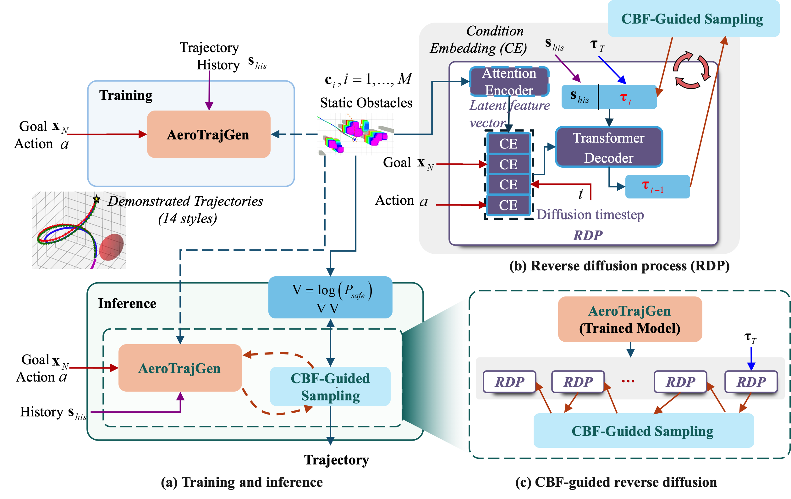

# AeroTrajGen: CBF-Guided Diffusion Trajectory Generation

PyTorch research code for **Collision-Aware Diffusion-Based Trajectory Planning via Control Barrier Function-Inspired Guidance**.

AeroTrajGen generates UAV maneuver trajectories conditioned on motion history, a target waypoint, maneuver style, and optional obstacle information. A Transformer diffusion model predicts clean trajectories, while inference-time barrier guidance steers samples away from spherical obstacles without retraining the model.



## Features

- Conditional trajectory generation with 23 synthetic maneuver styles.
- Optional obstacle encoding and obstacle-aware training loss.
- Exponential (`standard`) and logistic barrier guidance during reverse diffusion.
- Paired guided and unguided evaluation with trajectory errors, collision rates, target attainment, and overall success.
- Training objectives for state reconstruction, endpoint accuracy, boundary continuity, smoothness, and position–velocity consistency.
- Automatic CUDA, Apple MPS, or CPU selection in the main script.

## Repository layout

| Path | Purpose |
| --- | --- |
| `AeroDM_ObstacleAware_Training_Test.py` | Main training, checkpoint loading, evaluation, and plotting entry point |
| `Trajectory_Gen.py` | Synthetic maneuver generation and trajectory utilities |
| `AeroDM_ObstacleAware_Training.py` | Additional training implementation |
| `AeroDM/` | Alternative model and guidance implementations |
| `Test/` | Trajectory-generation helpers and experimental scripts |
| `MPD_Plan_TRO.py` | MPD-style planning experiment |
| `SafeDiffuser.py` | Separate diffusion-planning experiment |
| `Flow_Matching_SafeTrj_pvR_Test.py` | Flow-matching experiment |
| `model/` | Local checkpoints; ignored by Git |
| `Results/` | Timestamped evaluation reports; ignored by Git |
| `Figures/` | Generated figures; ignored by Git |
| `Doc/` | Local manuscript sources; ignored by Git |

Experimental scripts have their own configurations and are not interchangeable with the main entry point.

## Installation

Run commands from the repository root. Create a Python virtual environment, then install the dependencies used by the main workflow:

```bash
python3 -m venv .venv
source .venv/bin/activate
python -m pip install --upgrade pip
python -m pip install torch numpy matplotlib scipy
```

On Windows, activate the environment with `.venv\Scripts\activate`. For CUDA, install a PyTorch build compatible with your system. Dependency versions are not currently pinned in this repository.

Create the output directories before running:

```bash
mkdir -p model Results Figures output/pdf
```

## Quick start

The main script uses the `Config` class near the top of [AeroDM_ObstacleAware_Training_Test.py](AeroDM_ObstacleAware_Training_Test.py), rather than command-line arguments.

### Train a model

Edit the following fields in `Config`:

```python
train_model = True
model_save_dir = "model"
model_filename = "aerodm_my_run.pth"
enable_obstacle_encoding = False
use_obstacle_loss = False
```

Then run:

```bash
python AeroDM_ObstacleAware_Training_Test.py
```

The script generates synthetic trajectories, splits them into training and test subsets (90%/10%), trains the model, saves a timestamped checkpoint and a checkpoint at `model_filename`, and runs evaluation. The current defaults generate 25,000 trajectories and train for 100 epochs, so a full run can be substantial. Reduce `_base_num_trajectories`, `num_epochs`, and `num_test_samples` for an initial workflow check; small runs are not representative of the reported results.

### Evaluate a checkpoint

Set `train_model = False` and point `model_filename` to an existing compatible checkpoint:

```python
train_model = False
model_save_dir = "model"
model_filename = "aerodm_my_run.pth"
barrier_type = "logistic"  # "standard" or "logistic"
guidance_gamma = 0.5
barrier_sigma = 0.3
num_test_samples = 200
```

Run the same command. Evaluation compares sampling with and without CBF guidance. Checkpoint loading restores model weights and normalization statistics; model dimensions and obstacle-encoder settings must match the checkpoint. The script also generates synthetic data before entering checkpoint-loading mode.

**Checkpoints are excluded from Git.** A fresh clone should not be assumed to contain the default checkpoint. Train a model first or supply a compatible checkpoint, including its normalization statistics.

## Configuration

The following values describe the current main script, not every historical experiment:

| Setting | Default | Meaning |
| --- | ---: | --- |
| `history_len` | 20 | Historical states used for conditioning |
| `seq_len` | 60 | Predicted future states |
| `delta_T` | 0.1 s | Sampling interval |
| `state_dim` | 10 | Speed, position (3), velocity (3), attitude (3) |
| `target_dim` | 4 | Target position and validity flag |
| `latent_dim` | 128 | Transformer hidden dimension |
| `num_layers` / `num_heads` | 4 / 4 | Transformer depth and attention heads |
| `diffusion_steps` | 60 | Diffusion steps |
| `batch_size` | 32 | Training batch size |
| `test_batch_size` | 8 | Evaluation batch size |
| `enable_obstacle_encoding` | `False` | Obstacle conditioning |
| `use_obstacle_loss` | `False` | Obstacle penalty during training |
| `barrier_type` | `"logistic"` | Inference-time barrier mapping |
| `guidance_gamma` | 0.5 | Barrier-guidance strength |
| `barrier_sigma` | 0.3 | Logistic smoothing parameter |
| `guidance_scale` | 2.0 | Classifier-free guidance scale |
| `show_flag` | `False` | Display plots interactively |
| `enable_test_plots` | `True` | Generate evaluation plots |

`guidance_gamma` and `guidance_scale` control different mechanisms. In the current sampler, the barrier coefficient is internally scheduled as `4000 * guidance_gamma * (1 - t / diffusion_steps)`; the configured value is not the raw gradient multiplier.

To train with obstacle awareness, enable both `enable_obstacle_encoding` and `use_obstacle_loss`. Changing encoder architecture requires a matching checkpoint or a new training run.

## Training objective

`AeroDMLoss` combines position and endpoint reconstruction, scalar-speed and attitude reconstruction, an optional obstacle penalty, history–prediction continuity, second-difference position smoothness, and kinematic consistency.

The current weights are:

| Configuration field | Value |
| --- | ---: |
| `last_xyz_weight` | 50 |
| `xyz_weight` | 1 |
| `vel_weight` | 0 |
| `other_weight` | 1 |
| `obstacle_weight` | 1 |
| `continuity_weight` | 5 |
| `acc_weight` | 1 |
| `kinematics_weight` | 10 |

Direct velocity supervision is disabled by its zero weight, while velocity channels remain constrained by kinematic consistency. Endpoint supervision is retained even though final-reference error is not a separate success criterion. Refer to `AeroDMLoss.forward` and `compute_obstacle_distance_loss` for exact reductions and normalization.

## Evaluation and outputs

A trajectory is counted as successful only when it satisfies all three conditions:

1. No sampled position intersects an obstacle.
2. Maximum position error relative to the reference trajectory is below **2 m**.
3. Final distance to the target is below **1 m**.

Success rate combines obstacle avoidance, reference fidelity, and target attainment. Missing one threshold does not by itself establish that a trajectory is infeasible or of low quality: a different obstacle-avoiding route can exceed the reference-error threshold. Read success rate alongside its component metrics.

Reports include mean absolute position error, RMSE, final-position error, target distance, collision rate, and mean minimum surface distance. The latter averages each trajectory's minimum signed distance to an obstacle surface; a positive aggregate does not imply every trajectory is collision-free.

Typical outputs are:

```text
Results/metrics_summary_YYYYMMDD_HHMMSS.txt
Figures/combined_9_test_cases.svg
output/pdf/test_samples_results.pdf
model/<configured-checkpoint-name>.pth
```

Some plots use fixed filenames and are overwritten by subsequent runs. Metric reports include configuration values; keep them together with the relevant checkpoint and figures.

### Example result

The local report `Results/metrics_summary_20261016_010500.txt` records a 200-trajectory run without obstacle encoding, using logistic guidance with `guidance_gamma=0.5` and `barrier_sigma=0.3`:

| Sampling | Collision rate | Mean AE (m) | Success rate | Mean min surface distance (m) |
| --- | ---: | ---: | ---: | ---: |
| Unguided | 94.5% | 0.4917 | 5.5% | -0.3843 |
| Guided | 14.5% | 0.7854 | 69.0% | 0.2991 |

This run illustrates the trade-off between collision avoidance and reference fidelity. These values are a recorded example, not a guarantee for a fresh run; the report and checkpoint are local artifacts excluded from Git.

## Reproducibility and scope

Record the checkpoint, full configuration, normalization statistics, test trajectories, obstacles, and random seeds when comparing guidance settings. The main script seeds the train/test permutation, but generates trajectories before that seed is set; the existing seed alone does not make the entire workflow deterministic. Use identical scenes and sampling conditions for controlled comparisons.

This is a simulation research implementation with known spherical obstacles and sampled-point collision checks. Barrier guidance does not by itself certify continuous-time collision avoidance, dynamic feasibility, or safe hardware execution. Current code, historical scripts, and manuscript experiments may use different state layouts and training settings.

## Batched classifier-free guidance

`Config.cfg_batch_forward = True` combines the conditional and style-null CFG branches into one model call with twice the sampling batch size. The goal, history and obstacles are retained in both branches; the CFG formula, barrier guidance and number of sampling steps are unchanged. This applies in evaluation mode; training mode retains sequential calls. Set the flag to `False` to restore sequential CFG when comparing performance or reducing peak activation memory. Unguided sampling and CFG scale 1 still use one ordinary forward call.

The local MPS comparison can be rerun with `python tests/benchmark_cfg_batch.py`. It uses the saved source in `output/cfg_batch_benchmark/before.py`, the configured checkpoint and shared scenes in `output/rk3588_20261017/scenes.npz`; these local artifacts must be present. Numerical comparisons use floating-point tolerances, since a different batch shape may change rounding.

## Local MPS inference benchmark

Measure unguided and guided inference for N trajectories with 60 diffusion steps:

```bash
python tests/benchmark_mps_inference.py --num-trajectories 200 --batch-size 32 --repeats 3
```

Requires an Apple Silicon PyTorch environment with MPS, NumPy and Matplotlib. The script loads the main script's configured checkpoint (override with `--checkpoint PATH`), uses its normalization, and prepares identical aerobatic histories and obstacle scenes for both modes. The main script's architecture and guidance settings are used, so an alternative checkpoint must match them. No training or plots are run. MPS must be available; the script does not silently fall back to CPU.

Both modes are warmed up for each batch shape, timed with MPS synchronization, and use matched random seeds. Guided includes the existing CFG and barrier guidance. Printed averages exclude checkpoint loading, data preparation and warm-up; they include the production sampling call and obstacle packing. JSON results, individual batch timings and settings are saved under `Results/` (override with `--output PATH`). The final partial batch is included in N.

The reported per-trajectory time is total sampling time divided by N, averaged over repeats. With batch sizes above 1, this measures amortized throughput; use `--batch-size 1` to measure serial per-trajectory latency. `--warmup` controls warm-up calls per mode and batch shape (default 2).

## Troubleshooting

- **Checkpoint not found:** train with `train_model=True`, or correct `model_save_dir` and `model_filename`.
- **Checkpoint shape mismatch:** match the model dimensions and obstacle-encoder configuration used during training.
- **Out of memory:** reduce training/evaluation batch sizes or the synthetic dataset size; the main script moves generated datasets to the selected device.
- **Headless environment:** run `MPLBACKEND=Agg python AeroDM_ObstacleAware_Training_Test.py` and leave `show_flag=False`.
- **Missing output directory:** create `model`, `Results`, `Figures`, and `output/pdf` before running.

### 多机轨迹生成 Demo

`demo_multi_agent.py` 是独立入口，复用 `AeroDM_ObstacleAware_Training_Test.py` 的模型定义和已有 checkpoint，不运行原文件的训练/测试入口，也不需要重新训练。

```bash
python demo_multi_agent.py --agents 4 --last-m 15 --collision-distance 1.0 --device cpu
# Apple GPU 可用时：--device mps；NVIDIA GPU：--device cuda:0
```

- 一个 batch 表示同一场景中的 N 架无人机，每架使用独立 history、target、style；不能把不同场景混入同一 batch。
- `--last-m` 指最后 M 个**反向扩散步**（t=M-1,...,0），不是未来轨迹的最后 M 帧。0 关闭机间引导。
- 对预测的干净轨迹 x0 反归一化，在每个未来时刻计算所有 i<j 的中心距离，使用平方距离侵入惩罚的排斥方向同步更新所有无人机；不比较不同时间点，不计算自身碰撞。
- `--collision-distance` 是物理坐标中的机间中心距离阈值。引导目标额外增加 `--safety-margin 0.05`；`--strength 0.4`、`--iterations 30` 控制每个扩散步内的修正。
- 默认把不同生成轨迹平移到共同的未来交汇点来构造测试条件。两次采样使用相同随机种子及相同 CFG 设置，仅机间引导不同。
- 输出 `output/multi_agent/comparison.png`、`trajectories.npz`、`metrics.json`。指标包括最小机间距离、低于阈值的“无人机对×时刻”数量、引导实际调用次数。

自定义输入：`python demo_multi_agent.py --input scene.npz --last-m 15`。NPZ 必须包含物理单位的 `history [N,20,10]`、`target [N,3]`、整数 `style [N]`（0–22）；history 长度以 checkpoint 配置为准。状态顺序为 `[speed,x,y,z,vx,vy,vz,roll,pitch,yaw]`。所有无人机必须使用同一坐标系和同步时间轴；输入文件中的 N 决定无人机数量。

该 demo 只修正位置通道，不约束速度/姿态一致性、历史连接或终点误差，也未检查采样点之间的连续时间碰撞。请以输出指标判断当前场景的避碰效果，不视为严格安全保证。

验证：`PYTHONPATH=. python tests/check_multi_agent.py`。
